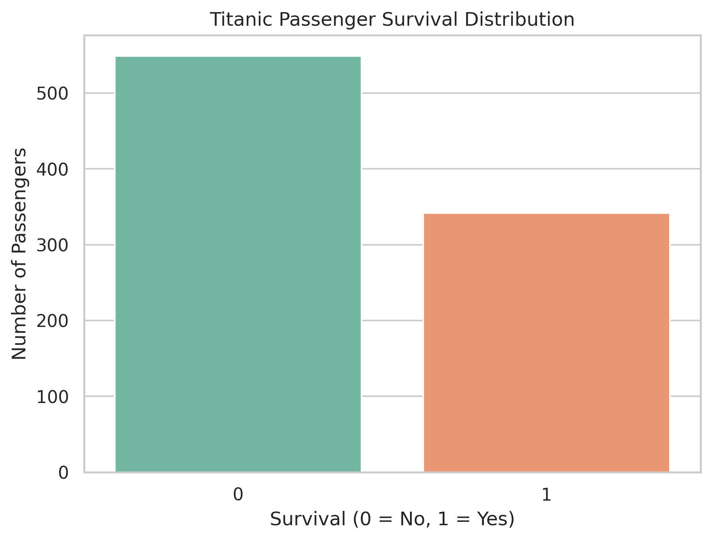
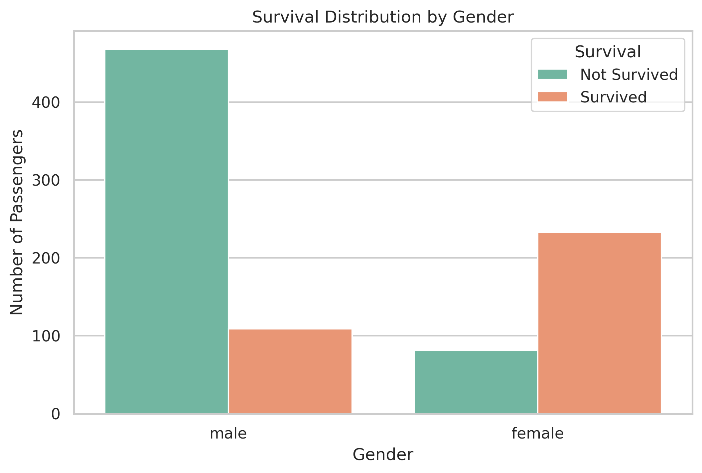
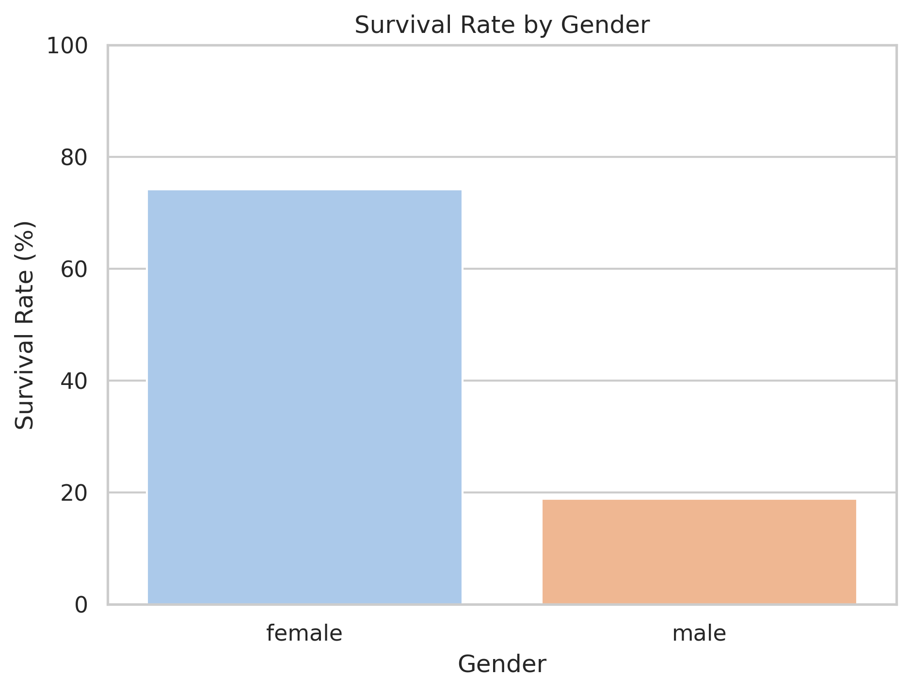
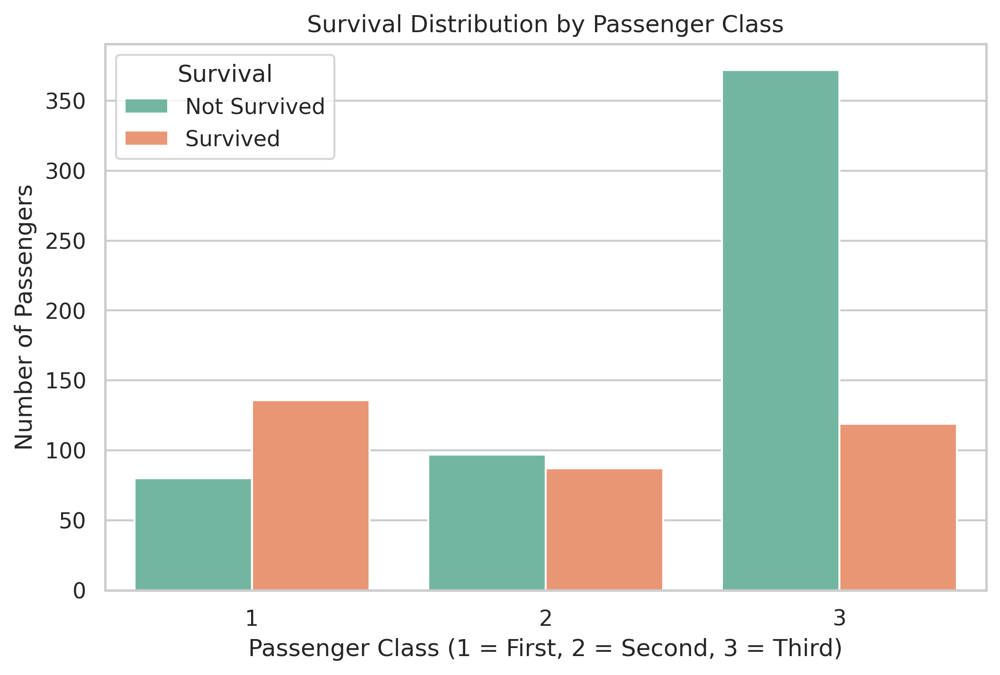
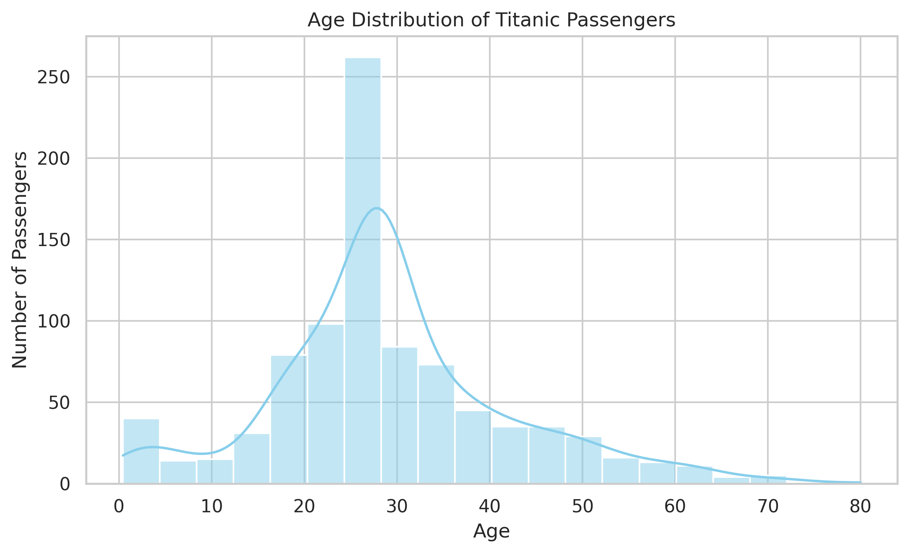
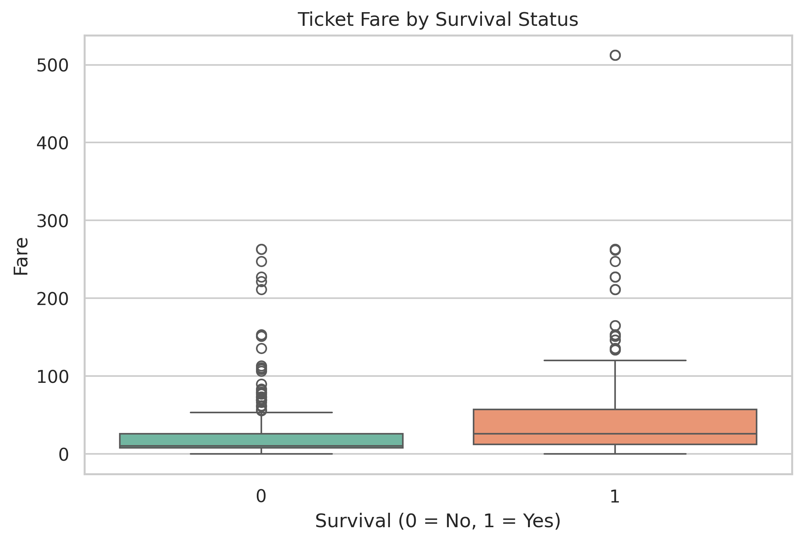
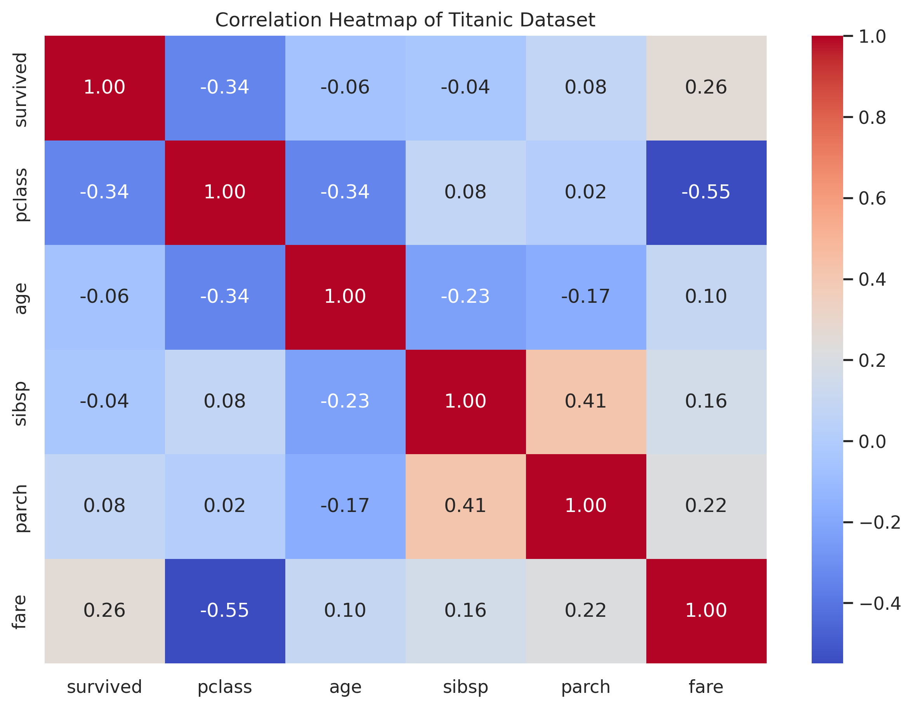

# PRODIGY_DS_02
## Titanic Dataset – Data Cleaning and Exploratory Data Analysis (EDA)

### 📌 Project Overview
This project was completed as **Task 02** of my Data Science Internship at **Prodigy InfoTech**.

The objective of this project is to perform data cleaning and exploratory data analysis (EDA) on the Titanic passenger dataset to identify patterns, relationships, and trends affecting passenger survival.

### 🎯 Project Objectives
- Identify and handle missing values.
- Inspect duplicate records.
- Perform statistical analysis.
- Explore relationships between passenger features.
- Analyze survival patterns based on gender, age, passenger class, and fare.
- Visualize findings using charts and a correlation heatmap.

### 📊 Dataset Information
- **Dataset:** Titanic Passenger Dataset
- **Source:** [Seaborn Titanic Dataset](https://github.com/mwaskom/seaborn-data/blob/master/titanic.csv)
- **Original Records:** 891
- **Original Columns:** 15
- **Cleaned Columns:** 14

### 🛠️ Technologies Used
- Python
- Pandas
- NumPy
- Matplotlib
- Seaborn
- Google Colab

### ⚙️ Data Cleaning Process

1. Loaded the Titanic dataset using Pandas.
2. Inspected the dataset structure and data types.
3. Identified missing values.
4. Filled missing age values using the median.
5. Filled missing categorical values in `embarked` and `embark_town` using the mode.
6. Removed the `deck` column because approximately 77.22% of its values were missing.
7. Checked duplicate records. A total of 116 duplicate rows were identified and retained for analysis because identical recorded values do not necessarily represent the same passenger.

### 📈 Exploratory Data Analysis

#### 1. Overall Survival Distribution

#### 2. Gender-wise Survival Distribution

#### 3. Survival Rate by Gender

#### 4. Survival Distribution by Passenger Class

#### 5. Age Distribution by Survival Status

#### 6. Ticket Fare by Survival Status

#### 7. Correlation Heatmap

### 🔍 Key Findings

**1. Overall Survival**
- Total passengers: 891
- Survivors: 342 (38.38%)
- Non-survivors: 549 (61.62%)

**2. Gender Analysis**
- Female survival rate: approximately 74.20%.
- Male survival rate: approximately 18.89%.
- Female passengers had a considerably higher survival rate.

**3. Passenger Class Analysis**
- First-class survival rate: approximately 62.96%.
- Second-class survival rate: approximately 47.28%.
- Third-class survival rate: approximately 24.24%.
- First-class passengers had the highest survival rate.

**4. Age Analysis**
- Median passenger age: approximately 28 years.
- Survivors and non-survivors had similar median ages.
- Both distributions contained outliers.

**5. Fare Analysis**
- Survivors generally had higher median ticket fares.
- Several high-value fare outliers were observed.

**6. Correlation Analysis**
- Passenger class and survival: -0.34.
- Fare and survival: +0.26.
- Age and survival: -0.06.

### 💡 Final Conclusion

The exploratory data analysis revealed meaningful patterns in the Titanic passenger dataset.

Gender and passenger class showed notable differences in survival outcomes. Ticket fare also had a positive association with survival, while age showed a very weak linear correlation.

This project provided practical experience in data cleaning, missing-value handling, statistical analysis, data visualization, and exploratory data analysis using Python.

### ▶️ How to Run the Project
1. Open `PRODIGY_DS_02.ipynb`.
2. Open the notebook in Google Colab.
3. Run all cells sequentially.
4. Explore the generated charts and analysis.

---
**Internship:** Prodigy InfoTech  
**Track:** Data Science  
**Task:** 02 – Data Cleaning and Exploratory Data Analysis  
**Repository:** PRODIGY_DS_02

**Author:** Suraj Maurya
